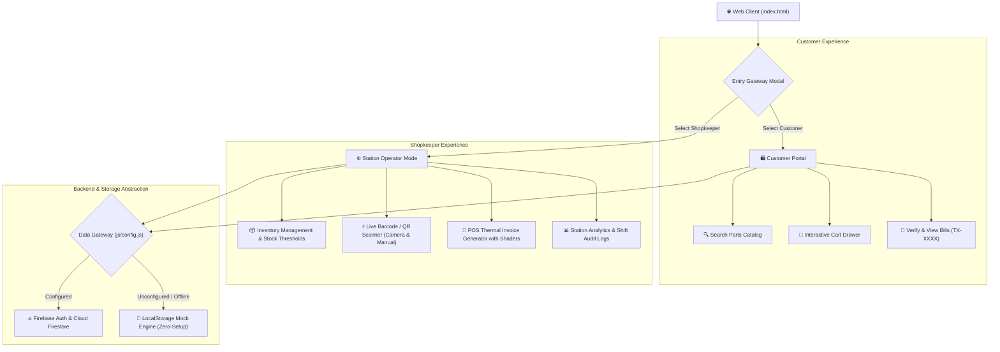
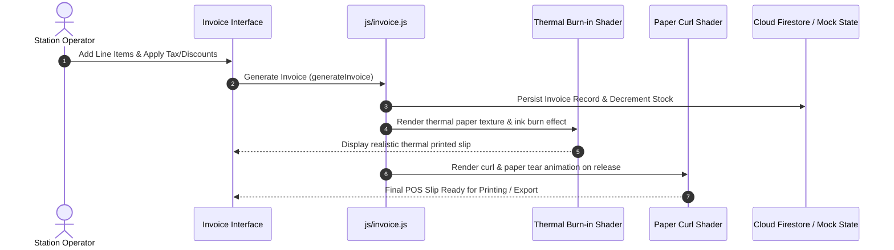

# ⚡ CRIT-SPARE: Critical Alert Inventory & POS System

[](https://github.com/sriram22622/CRIT-SPARE)
[-7b2cbf?style=flat-square)](https://github.com/sriram22622/CRIT-SPARE)
[](https://github.com/sriram22622/CRIT-SPARE)
[](https://github.com/sriram22622/CRIT-SPARE)


**CRIT-SPARE** is a cyber-industrial spare parts inventory, real-time stock alert system, and Point-of-Sale (POS) billing application built with high-performance vanilla ES Modules, custom WebGL/Canvas shader effects, and seamless Firebase integration with offline mock capability.

Designed for high-throughput station operators, hardware warehouses, and retail customers who demand real-time stock visibility and instant invoice verification.

---

## 🧭 System Architecture & Dual-Role Flow

CRIT-SPARE features an interactive **Cyber Entry Gateway** allowing users to switch dynamically between **Station Operator (Shopkeeper)** mode and **Customer Portal** mode.



---

## 🎨 Visual POS & Shader Pipeline

When invoices are generated, CRIT-SPARE invokes custom GPU-accelerated canvas shaders to deliver a tactile, physical receipt feel:



---

## 🛡️ Security, API Keys & Environment Hygiene

CRIT-SPARE is engineered with strict separation between public client assets and sensitive secrets:

```mermaid
graph LR
    subgraph Git Protected (Never Committed)
        SEC1[".env / .env.*"]
        SEC2["js/firebase-config.local.js"]
        SEC3["Service Account Keys (*.json)"]
        SEC4["scratch/ (Integration Tests)"]
    end

    subgraph Git Tracked (Safe for Version Control)
        PUB1[".env.example"]
        PUB2["js/firebase-config.example.js"]
        PUB3["firestore.rules (Security Isolation)"]
        PUB4["HTML / CSS / JS Application Code"]
    end
```

### Key Security Practices in CRIT-SPARE:
1. **Never Commit Secrets:** `.env`, `js/firebase-config.local.js`, and any `serviceAccount*.json` files are excluded in `.gitignore`.
2. **Client Config vs Admin Secrets:** Firebase Web App client keys (`apiKey`, `projectId`, etc.) are designed for browser initialization and are constrained via Firebase Console API key restrictions and authorized domains. Never commit Admin SDK private keys to this repository.
3. **Multi-Tenant Firestore Rules:** `firestore.rules` enforces strict shop-level isolation:
   - Operators can only read and write data belonging to their verified `shopId`.
   - Cross-shop data leakage is prevented at the database layer.
4. **Offline Mock Mode:** When no credentials are provided, CRIT-SPARE automatically activates its built-in Mock State engine, allowing full functional testing without risking production cloud credentials.

---

## 📂 Project Directory Structure

```plaintext
CRIT-SPARE/
├── .env.example             # Template for local environment variables
├── .firebaserc              # Firebase CLI project alias
├── .gitignore               # Strict ignore list for secrets, logs, and temp scripts
├── 404.html                 # Error fallback screen
├── auth.html                # Station operator sign-in & phone verification
├── dashboard.html           # Shift metrics, operator profile & telemetry
├── firebase.json            # Firebase hosting and rules deployment config
├── firestore.rules          # Granular multi-tenant Firestore security rules
├── index.html               # Main landing page & Cyber Entry Gateway
├── inventory.html           # Full stock table, low-stock alerts & bin mapping
├── invoice.html             # Point-of-Sale thermal receipt generator
├── legal.html               # Legal disclosures and terms of service
├── privacy.html             # Privacy policy & data handling disclosures
├── robots.txt               # Search engine crawler policies
├── scan.html                # Camera barcode/QR scanner & manual SKU lookup
├── sitemap.xml              # SEO sitemap
├── terms.html               # Terms of use
│
├── css/
│   └── style.css            # Cyber-industrial theme, responsive layout & animations
│
├── images/
│   ├── og-preview.png       # OpenGraph banner preview
│   └── og-preview.svg       # Vector brand assets
│
└── js/
    ├── analytics.js         # Shift performance metrics & logging
    ├── api.js               # Central API gateway (switches between Firebase & Mock)
    ├── auth.js              # Authentication controller & session state
    ├── config.js            # Environment detection & mock storage keys
    ├── customer.js          # Customer cart drawer, item stepper & slip verification
    ├── dashboard.js         # Real-time metrics calculations & charts
    ├── firebase-api.js      # Direct Firestore & Firebase Auth operations
    ├── firebase-config.example.js  # Safe template for client Firebase config
    ├── firebase.js          # Dynamic Firebase SDK loader
    ├── inventory.js         # Inventory CRUD, stock alerts, filtering
    ├── invoice.js           # POS bill calculation & slip renderer
    ├── main.js              # Global application bootstrapper & gateway modal
    ├── scan.js              # Barcode/QR video stream & ZXing integration
    └── shaders/
        ├── paper-curl.js    # Canvas paper physics shader
        └── thermal-burn-in.js # Canvas thermal printing burn effect
```

---

## 🚀 Getting Started

### 1. Prerequisites
- Modern web browser (Chrome, Edge, Firefox, Safari) supporting ES Modules and WebGL/Canvas.
- A local HTTP server (such as VS Code **Live Server**, Python `http.server`, or Node `serve`).

### 2. Local Setup
```bash
# Clone the repository
git clone https://github.com/sriram22622/CRIT-SPARE.git
cd CRIT-SPARE

# Copy the Firebase config template (optional - works in Mock Mode by default)
cp js/firebase-config.example.js js/firebase-config.local.js
```

### 3. Running with Live Server
1. Open the project folder in VS Code.
2. Right-click `index.html` and click **"Open with Live Server"**.
3. The application will boot instantly in **Mock Mode** (zero setup required).

---

## 🔍 Note on Git & Hidden Files on Windows

If you are browsing this repository in Windows File Explorer and do not see the `.git` folder:
- By default, Git repositories place internal metadata in `.git`, which Windows may flag with the **Hidden** attribute.
- To display hidden items in Windows 11/10:
  - Open File Explorer ➜ Click **View** ➜ Click **Show** ➜ Check **Hidden items**.
- You can also inspect git status anytime from PowerShell or terminal:
  ```powershell
  git status
  git log --oneline -n 5
  ```

---

## 📄 License & Attribution

Designed and engineered for **CRIT-SPARE** critical alert inventory management. All rights reserved.
